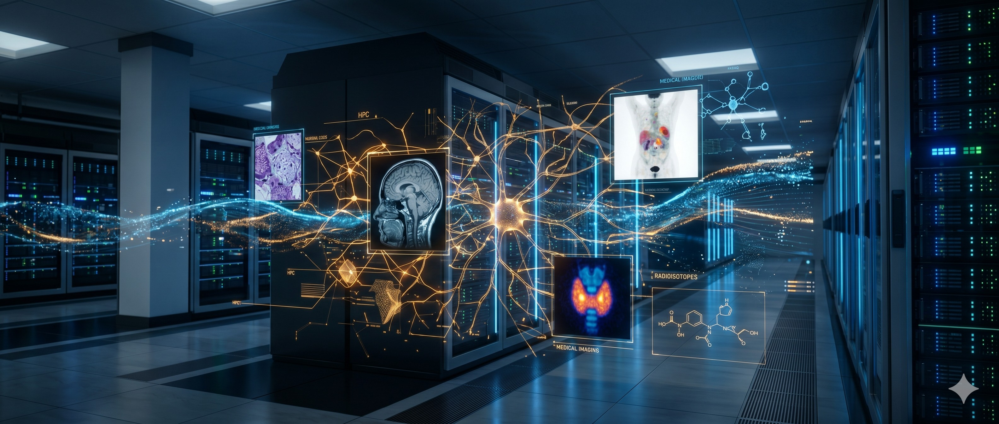

::: {.callout-warning title="Coming Soon"}
We're finalizing legal aspects within IPEN before we can start offering these services! Stay tunned!
:::

::: {.column-screen .bg-light .border-bottom .py-5 .mb-5}
::: {.container}
::: {.grid}

::: {.g-col-12 .g-col-md-7 .my-auto}
# AI and Data Science Solutions

**CINAS** (Nuclear and Health Computing and Artificial Intelligence Group) provides high-fidelity specialized technical services under the framework of the **Brazilian Innovation Law (Art. 8, Law 10.973/2004)**.

We focus on applying advanced algorithms and robust computational infrastructure to solve complex challenges in healthcare, industry, and scientific research.

<a href="mailto:seu-email@ipen.br" class="btn btn-primary btn-lg mt-4 shadow">Request Technical Proposal</a>
:::

::: {.g-col-12 .g-col-md-5}
{.img-fluid .rounded-4 .shadow-lg style="max-height: 400px; width: 100%; object-fit: cover;"}
:::

:::
:::
:::

::: {.container}
## Our Core Expertise {.text-center .mb-5}

::: {.grid}

::: {.g-col-12 .g-col-md-4}
::: {.card .h-100 .shadow-sm .border-0 .p-3}
### 🖥️ HPC & Machine Learning
Large-scale model training on high-performance hardware.
- Dual NVIDIA RTX A6000 GPUs
- Epyc Processors (256 total cores)
- 144TB High-performance storage
:::
:::

::: {.g-col-12 .g-col-md-4}
::: {.card .h-100 .shadow-sm .border-0 .p-3}
### 📊 Data Engineering
Curation and Big Data pipelines at national scale (**DATASUS, IBGE, INMET, ANS, CMED, IPEA**).
- Legacy database conversion to columnar Apache Parquet
- Medallion Architecture and transversal Star Schema
- ACID governance and sub-second analytics via DuckDB

<a href="datalake.en.qmd" class="btn btn-outline-primary btn-sm mt-3"> Explore our Data Lake</a>
:::
:::

::: {.g-col-12 .g-col-md-4}
::: {.card .h-100 .shadow-sm .border-0 .p-3}
### 🧠 Generative AI & RAG
On-Premise Large Language Model (LLM) implementation.
- RAG systems for private documents
- Full privacy and data security
- Specialized fine-tuning
:::
:::

::: {.g-col-12 .g-col-md-4}
::: {.card .h-100 .shadow-sm .border-0 .p-3}
### 🩺 Computer Vision
Automated analysis for medical imaging and signals.
- AI-aided diagnostics
- Image segmentation and classification
- Sensor data processing
:::
:::

::: {.g-col-12 .g-col-md-4}
::: {.card .h-100 .shadow-sm .border-0 .p-3}
### 📉 Operations Research
Advanced mathematical and statistical modeling.
- Logistics and industrial optimization
- Complex data analysis
- Strategic decision support
:::
:::

::: {.g-col-12 .g-col-md-4}
::: {.card .h-100 .shadow-sm .border-0 .p-3}
### 📈 Technical Interfaces
Dashboards and APIs for data visualization.
- Developed with Quarto and Shiny
- Project-based interface delivery
- Custom data APIs
:::
:::

:::
:::

---

::: {.text-center .text-muted .mt-5 .mb-5}
*All listed services are specialized technical activities, provided on a project-by-project basis and are non-continuous, in compliance with the Brazilian Legal Framework for Science, Technology, and Innovation.*
:::